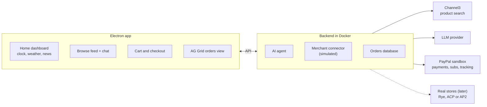

# Idea 1: AI shopping OS (B2C)

Live doc: https://claude.ai/artifact/LQHLAS7RQSeQtH6yhdEZew

## Pitch

A fullscreen desktop app for macOS and Windows that feels like a shopping OS. You open it the way you'd walk into a mall: no ads, no 15 tabs, no 15 different checkouts. A calm home screen shows a clock, weather, news, a calendar of your orders and your subscriptions. An AI agent lets you browse when you don't know what you want, builds one cart from products across many stores, and pays once with PayPal.

The bet: people won't want to search 15 websites for an HDMI cable. One AI-driven store on top of every store is feasible today.

## Prize fit

| Prize | Why it fits |
| --- | --- |
| Best Use of Agentic Commerce (main) | The agent browses, builds a cart and pays |
| AG Grid | Orders, subscriptions, offer comparison |
| Channel3 | Channel3 is the product catalog, so it's central |
| Best Demo Delivery (fallback) | Very visual, easy to film |

## Core demo flow

1. The app opens fullscreen on the home screen: clock, weather, news, order calendar, subscriptions.
2. The user says "I don't know what I want, show me cozy stuff for winter under $50."
3. The agent searches Channel3 and shows a browsable feed from many stores.
4. The user picks a few items; the agent builds one combined cart and compares offers (AG Grid).
5. The user pays once with PayPal (sandbox).
6. The order appears in the calendar and the AG Grid orders view, with tracking status.
7. Later: "did my order arrive?" or "pause my water subscription", answered through PayPal.

## Stack

| Layer | Tool | Role |
| --- | --- | --- |
| App shell | Electron wrapping a web app | Fullscreen on macOS and Windows; the same web build is hosted for judges |
| Backend | Docker | `docker compose up` starts everything |
| Product discovery | Channel3 | Search across many stores |
| Payments and orders | PayPal Agent Toolkit (sandbox) | Orders, subscriptions, shipment tracking |
| Data views | AG Grid | Orders, subscriptions, offers |
| Agent | LLM with tool calling | Talks to the user, calls Channel3 and PayPal |

**Ordering:** the sandbox can't place orders at other stores, so our app acts as the store. The user pays us once and a pluggable "merchant connector" takes the order. It's simulated in the demo; Rye, ACP or AP2 would plug into the same slot later.

## Architecture

## Scope

**In:** the core flow end to end in the sandbox; home screen widgets; subscriptions and tracking limited to what goes through PayPal; Docker, hosted build, README and license.

**Later (pitch only):** real orders at real merchants; tracking packages that didn't go through us; merchants' own subscriptions outside PayPal.
