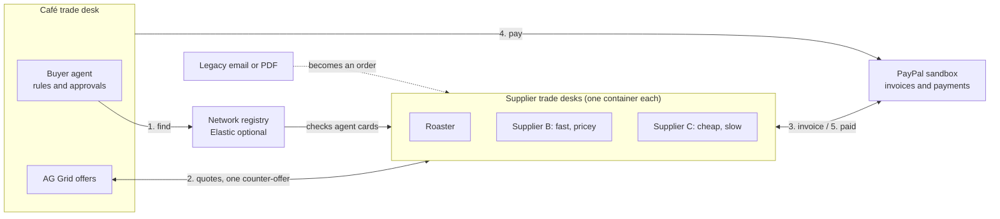

# Idea 2: AI trade desk for B2B

Live doc: https://claude.ai/artifact/JBHPqd3bswL5NfVqDQra2f

## Pitch

An AI trade desk that every small business gets for both buying and selling, with PayPal underneath. Small B2B trade still runs on emailed PDFs, purchase orders, net-30 invoices and people chasing payments by hand. The trade desk turns that into clean orders, PayPal invoices and payments, and when both sides use it, their agents settle deals directly.

**Who it's for:** small wholesalers and their customers, e.g. a coffee roaster selling to 40 cafés.

## How it works

- **Selling side:** orders arrive any way (email, PDF, photo). The agent turns them into clean orders, sends PayPal invoices, tracks payments and chases late payers in one AG Grid ledger.
- **Buying side:** the owner sets reorder rules and approval limits ("keep 20 kg of beans, max $15/kg, ask me above $500"). The agent spots low stock and contacts suppliers.
- **Agent to agent:** if both sides use the trade desk, agents agree on price and delivery directly; otherwise the agent falls back to email.
- **Partner timeline:** one screen per business partner with every order, invoice, payment and message.

## Supplier network

Suppliers advertise their trade desk as open for business. A buyer states a need ("50 kg of Brazilian beans, prioritize delivery speed") and its agent asks every matching supplier at once.

1. The buyer agent turns the request into a structured order (product, origin, quantity, priority, budget).
2. It sends the request to every matching supplier in the network.
3. Supplier agents quote within their owner's limits; offers stream into an AG Grid table, ranked by the buyer's priority.
4. The buyer agent makes **one** counter-offer to the top 2 or 3.
5. It recommends a winner with a one-line reason; the owner approves.
6. The supplier sends a PayPal invoice and the buyer pays it.

For the demo, the network is seeded with 4 or 5 simulated suppliers with different behaviour (cheap but slow, fast but pricey, low stock).

## Discovery and trust

- **Find:** a central registry answers "who sells what, and delivers where". Elastic could power this search, but it's optional (no Elastic prize).
- **Verify:** when a business joins, the registry fetches an A2A-style agent card from its own domain, e.g. `coffeamar.com/.well-known/agent-card.json` (exact file name to confirm). This proves the domain really runs that agent.
- **Talk:** verified agents call each other's APIs directly to quote, counter and accept.
- **Pay:** money only moves through PayPal invoices.
- **Run:** everything ships in Docker; each simulated supplier is its own container with its own agent card and API.

## Architecture

## Demo flow (split screen: café vs roaster)

1. The café's agent sees beans below 20 kg and starts a reorder within its rules.
2. It asks suppliers for quotes; offers stream in.
3. The order is above $500, so the owner approves with one tap.
4. The roaster sends a PayPal invoice; the café pays it in the sandbox.
5. The roaster's AG Grid ledger updates live from "invoiced" to "paid".
6. A legacy customer emails a messy PDF order; the agent turns it into an invoice.
7. A week later, an unpaid invoice gets a polite automatic reminder.

## Prize fit

| Prize | Why it fits |
| --- | --- |
| Best Use of Agentic Commerce (main) | Agents find, negotiate and pay through PayPal with human approval limits |
| Most Impactful (alternative) | Small suppliers lose hours and cash flow to manual invoicing |
| AG Grid | Ledger, live offers and partner history are the core screens |
