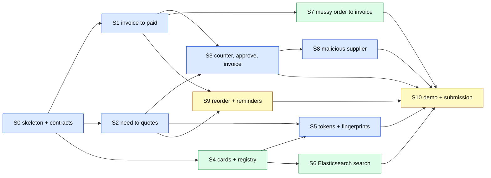

# Build plan: vertical slices

Drafted Oct 28, 2026. Builds on [architecture.md](../architecture.md); where the two disagree, architecture.md wins. A senior reviewer is reading the architecture, so expect these specs to change. Each slice is its own file so one can be rewritten without touching the rest.

A **vertical slice** goes through every layer it needs (UI, Spring, database, PayPal or LLM, `docker compose`) and ends in something you can show on screen. Each slice is demoable on its own and leaves `main` runnable.

## The first slice: S1, invoice to paid

Start with [S0](s00-skeleton-and-contracts.md) (one day of skeleton), then [S1](s01-invoice-to-paid.md): the roaster creates an invoice in the AG Grid ledger, a real PayPal sandbox invoice is sent, the buyer pays it on PayPal's hosted page, and the ledger row flips to PAID on its own.

Why this one first:

- **It's the end of every flow.** Negotiation (S3) and messy orders (S7) both finish by calling the invoice code S1 builds.
- **It's the least likely to change after review.** PayPal's Invoicing API is fixed; the parts the reviewer is most likely to question (tokens, enrollment, search) come later on purpose.
- **It retires the biggest external risk early.** Sandbox credentials, OAuth, invoice states and the hosted pay page are where surprises hide.
- **It gives judges the core PayPal moment** even if everything after it slips.

## All slices

| # | Slice | Demo moment | Depends on | Owner (suggested) | Days | Status |
| --- | --- | --- | --- | --- | --- | --- |
| [S0](s00-skeleton-and-contracts.md) | Skeleton and contracts | `docker compose up` brings up every service, all healthy | none | Matei | 1 | Done (#9) |
| [S1](s01-invoice-to-paid.md) | Invoice to paid | Ledger row goes SENT to PAID live after a sandbox payment | S0 | Matei | 2 | Done (#19) |
| [S2](s02-need-to-quotes.md) | Post a need, get quotes | Café types a need; quotes from 4 suppliers (roaster + 3 SIMULATED) stream into an AG Grid table. Decided Oct 29: quotes come back synchronously in the RFQ response; the RFQ carries no budget or priority. | S0 | Matei | 2 | Done (#20, #21) |
| [S3](s03-counter-approve-invoice.md) | Counter, approve, invoice | One counter round, one-tap approval above the limit, invoice arrives | S1, S2 | Matei | 1.5 | Done (#23) |
| [S4](s04-agent-cards-and-registry.md) | Landing pages, agent cards, registry | Supplier joins the network; registry verifies its card on its own domain | S0 | Robert | 2 | Planned |
| [S5](s05-tokens-and-fingerprints.md) | Scoped tokens and fingerprints | A call without a valid token is refused; registry shows fingerprints only | S2, S4 | Matei | 2 | Planned |
| [S6](s06-elasticsearch-search.md) | Elasticsearch supplier search | "Brazilian beans, delivers to me" finds suppliers with no shared keywords | S4 | Robert | 1.5 | Planned |
| [S7](s07-messy-order-to-invoice.md) | Messy order to invoice | Pasted email or PDF becomes a draft invoice the owner sends | S1 | Robert (Matei pairs on Spring AI) | 1.5 | Planned |
| [S8](s08-malicious-supplier.md) | Malicious supplier | A prompt-injected quote is blocked by the Java policy engine | S3 | Matei | 0.5 | Planned |
| [S9](s09-reorder-and-reminders.md) | Reorder trigger and late-payer reminder | Low stock starts the RFQ by itself; an overdue invoice gets a reminder | S2, S1 | Either | 1.5 | Planned |
| [S10](s10-demo-and-submission.md) | Demo, README, submission | The 3-minute video, the README run steps, the Devpost entry | all | Robert leads, both | 2 | Planned |

Total about 17.5 person-days against about 16. The cut line is in [What to cut if we're behind](#what-to-cut-if-were-behind).

## Dependency map

Blue is Matei, green is Robert, yellow is either or both.

## Who works where

The split follows folders, so the two of us rarely edit the same files:

- **Matei: `trade-desk/`** (desk app, agents, policy engine, PayPal) and the desk screens in `frontend/`.
- **Robert: `registry/` and `web/`** (registry app, Elasticsearch, landing pages, agent cards), plus S7 inside `trade-desk/` behind its own package, and QA on every slice.
- **Shared, small PRs only:** `docker-compose.yml`, `.env.example`, `contracts/`, root README.

Each slice's acceptance criteria double as Robert's QA script: run them on a fresh clone before the slice's PR merges.

## Suggested schedule

| Day | Matei | Robert |
| --- | --- | --- |
| Oct 29 | S0 skeleton and contracts | |
| Oct 30 to 31 | S1 invoice to paid | |
| Nov 1 | S2 need to quotes (start) | |
| Nov 2 | S2 (finish) | S4 landing pages and agent cards, QA S1 |
| Nov 3 | S3 counter, approve, invoice | S4 registry enrollment |
| Nov 4 | S3 (finish), S8 malicious supplier | S6 Elasticsearch search |
| Nov 5 to 6 | S5 tokens and fingerprints | S6 (finish), S7 messy order |
| Nov 7 | S9 reorder trigger | S7 (finish), QA S3, S5 |
| Nov 8 | Buffer and bug fixes | S9 reminder or buffer |
| Nov 9 to 10 | S10 polish and recording | S10 polish and recording |
| Nov 11 | Submit | Submit |

Until Nov 2 Matei is alone, so S0, S1 and S2 come first: they're the spine of the demo and don't depend on anything the reviewer is likely to change.

## What to cut if we're behind

In order, cut from the top:

1. S9 late-payer reminder (show a "coming soon" label instead).
2. S6 Elasticsearch: keep the Postgres search from S4, which is the fallback anyway.
3. S5 audit extras: keep tokens, fingerprint logging, the per-message JWS (the fingerprint hash covers the signed envelope), the Network audit grid and the "verify" button. Only the checks are left to tests.

PDF input in S7 stays in; the cut list stops at item 3.

Never cut S1, S2, S3 or S8: they are the demo.

## When the review comes back

Each spec ends with a **Review-sensitive** list naming what is most likely to change. Update the affected slice files and this table in one PR, and note the change in [architecture.md](../architecture.md) if it's a design decision.

## Spec template

Each slice file uses the same headings: Goal, Demo moment, Depends on, In scope, Out of scope, Contracts, Data, Acceptance criteria, Review-sensitive. Copy one when adding a slice.
